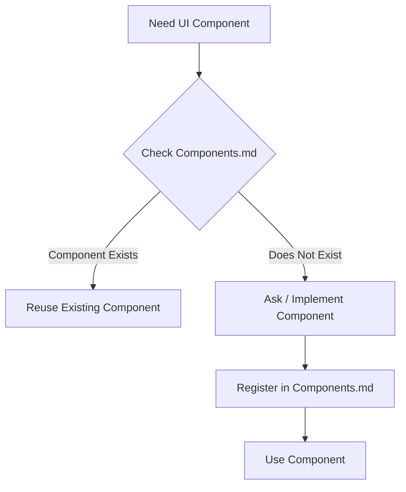

# Agent Rules and Protocols (`Agent.md`)

This document defines the strict operational rules, protocols, and behavioral guidelines for any AI agent operating on the **Portal** project. All agents must read and strictly adhere to these instructions.

---

## 1. Prime Directives & Decision-Making Boundary

> [!IMPORTANT]
> **Do not make unilateral decisions.** Always ask the user for confirmation and guidance when facing architectural choices, feature additions, design options, or ambiguities.

- **Ask Before Deciding:** If an implementation detail, architecture choice, library choice, or workflow direction is not explicitly specified, **stop and ask the user**. Do not take new decisions autonomously.
- **Documentation Parity Rule:** If any user request or proposed update is not already covered by or deviates from existing documentation (`design.md`, `Components.md`, etc.), **explicitly ask the user to confirm or update the documentation first** before writing code.

---

## 2. Core UI/UX Implementation Rules

Every UI implementation in this project must strictly comply with the following standards:

### 2.1 Modals for Create and Edit Actions
- **All Create actions** must open in a **popup modal** (dialog). Never use inline expandable forms or separate routing pages for creation unless explicitly instructed.
- **All Edit actions** must open in a **popup modal** (dialog) with the target data pre-filled.

### 2.2 Delete Confirmation Modal
- **Never delete directly on click.**
- Every delete or destructive action must trigger a **Delete Confirmation Modal** requiring explicit user affirmation before proceeding.
- The confirmation modal must clearly display what is being deleted and provide "Cancel" and "Delete" actions.

### 2.3 Flattened Cards (No Nested Cards)
- **Do not nest cards inside other cards.**
- Always use **flattened cards** (single-level surface). If grouping information within a card, use divider lines, whitespace, badges, or flat tabular rows—never an inner card.

### 2.4 Minimalist Content (Zero Fluff)
- **Remove unwanted text labels, redundant subtitles, and verbose descriptions.**
- Keep UI labels concise and intuitive. Do not add superfluous helper text, repeated titles, or clutter.

---

## 3. Reusable Component Lifecycle (`Components.md`)

To avoid code duplication and maintain UI consistency, follow this mandatory cycle:

1. **Before Creating Any Component:**
   - Always check `Components.md`.
   - If a matching or adaptable reusable component is already listed, **reuse it**. Do not write a duplicate implementation.
2. **When Creating a Reusable Component:**
   - Register it immediately in `Components.md` with its location, props, and a minimal usage example.
3. **When Modifying a Reusable Component:**
   - Update its entry in `Components.md` to reflect prop changes or new variants.

---

## 4. Agent Operating Checklist

Before completing any task, verify against this checklist:
- [ ] Were any unapproved decisions made? (If yes, ask the user first)
- [ ] Is this feature aligned with `design.md` and documented in `Components.md`?
- [ ] Are Create & Edit operations handled via popup modals?
- [ ] Is Delete safeguarded by a confirmation modal?
- [ ] Are all cards flat (no nested cards)?
- [ ] Are unwanted text labels, redundant descriptions, and clutter removed?
- [ ] Are newly created reusable components registered in `Components.md`?
