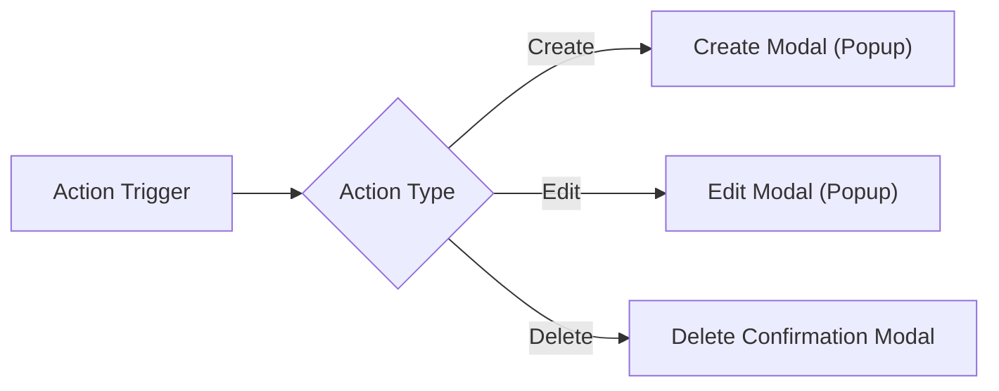

# Design Guidelines & System Specifications (`design.md`)

This document outlines the visual language, layout principles, and interaction standards for the **Portal** application. All components and views must conform to these design rules.

---

## 1. Core Principles

1. **Clean & Minimalist:** Remove unwanted text labels, verbose descriptions, and filler copy. Prioritize functional clarity and white space over descriptive fluff.
2. **Flattened Hierarchy:** Avoid visual clutter and excessive nesting. All cards must be single-level (flat).
3. **Focused Context:** Create and Edit operations stay in-context using popup modals instead of page redirects.
4. **Safety & Intent:** Destructive actions always require an explicit confirmation modal.

---

## 2. Card Architecture (Flattened Cards Only)

> [!WARNING]
> **Nested cards are strictly prohibited.** Never render a card inside another card.

### Rules for Cards
- **Single-Layer Elevation:** Cards should have a subtle border (`1px solid var(--border-color, #e2e8f0)`) or light shadow (`box-shadow`), but never enclose an inner element that has its own card background, border, or card-like shadow.
- **Internal Grouping:** To group items inside a card:
  - Use whitespace and spacing (`gap-4`, `padding`).
  - Use simple dividers (`border-t` or `<hr />`).
  - Use tabular rows or list items with transparent backgrounds.
  - Use lightweight badges or subtle tag chips.

### Visual Comparison

````carousel
```tsx
// ❌ WRONG: Nested Cards
<div className="card outer-card">
  <h3>Project Title</h3>
  <div className="card inner-card">
    <p>Inner details</p>
  </div>
</div>
```
<!-- slide -->
```tsx
// ✅ CORRECT: Flattened Card Structure
<div className="card flat-card">
  <div className="card-header">
    <h3>Project Title</h3>
    <span className="badge">Active</span>
  </div>
  <div className="card-body">
    <div className="detail-row">
      <span className="label">Owner:</span>
      <span className="value">John Doe</span>
    </div>
  </div>
  <div className="card-footer">
    <button className="btn-edit">Edit</button>
    <button className="btn-delete">Delete</button>
  </div>
</div>
```
````

---

## 3. Modal (Popup) System

Modals provide focused task environments for creating, modifying, and deleting records without taking the user out of their current context.



### 3.1 Common Modal Specifications
- **Backdrop:** Semi-transparent overlay (`rgba(0, 0, 0, 0.5)`) with optional backdrop blur (`backdrop-blur-sm`).
- **Positioning:** Centered vertically and horizontally in the viewport.
- **Dismissal:**
  - `Escape` key closes the modal (with confirmation if unsaved changes exist).
  - Clicking outside the modal or clicking the "X" / "Cancel" button closes it.
- **Focus Trap & Scroll Lock:** Background scroll locked while modal is open; focus trapped within modal controls.

### 3.2 Create Modal
- **Purpose:** Used for creating new records, entities, or items.
- **Layout:**
  - Header: Concise title (e.g., `New Item` or `Add Project`). No unnecessary descriptive paragraph underneath.
  - Body: Required input fields with clean labels and clear validation states.
  - Footer: Aligned right: `Cancel` (secondary/outline) and `Create` or `Save` (primary).

### 3.3 Edit Modal
- **Purpose:** Used for modifying existing items.
- **Layout:**
  - Header: Concise title (e.g., `Edit Item`).
  - Body: Form fields pre-populated with current item values.
  - Footer: `Cancel` (secondary) and `Save Changes` (primary).

### 3.4 Delete Confirmation Modal
- **Purpose:** Prevents accidental deletion of data.
- **Layout:**
  - Header / Icon: Danger indicator (e.g., warning badge or red accent icon).
  - Title: Clear prompt (e.g., `Delete Item?`).
  - Body: Specific identification of the target (e.g., `Are you sure you want to delete "Project Alpha"? This action cannot be undone.`). No irrelevant filler text.
  - Footer: `Cancel` (neutral/secondary) and `Delete` (destructive / red accent button).

---

## 4. Typography & Label Guidelines

To ensure a streamlined, clutter-free user experience:

- **Eliminate Unnecessary Labels:**
  - Do not use redundant helper descriptions below every input (e.g., avoid: *"Please type your title in this title field"*).
  - Use clear, self-explanatory placeholders and clean input labels.
- **Concise Microcopy:**
  - Buttons: Use concise action verbs (`Create`, `Save`, `Delete`, `Filter`, `Export`).
  - Headers: Straightforward names without explanatory filler.
  - Status Indicators: Use simple status badges (`Active`, `Draft`, `Archived`) instead of narrative sentences.

---

## 5. Interaction & Styling Conventions

| Element | Default State | Hover / Focus | Active / Destructive |
| :--- | :--- | :--- | :--- |
| **Primary Button** | Solid brand color, high contrast text | Slight brightness/darkness shift, focus ring | Active depression, loading spinner |
| **Secondary Button**| Neutral border or light tint | Subtle background highlight | Neutral active state |
| **Destructive Button**| Red / Danger outline or solid red | Darker red background | Red focus ring |
| **Card** | Flat surface, subtle border, rounded corners (`8px` - `12px`) | Optional subtle border highlight | No nested card inside |
| **Modal Window** | High contrast background (white / dark surface), crisp shadow | - | Smooth fade-in and scale-in |
