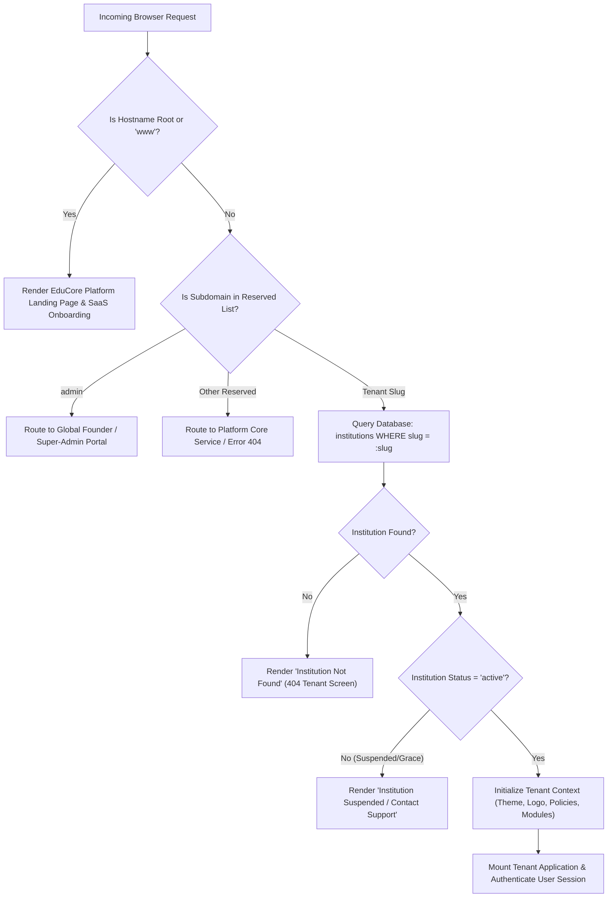
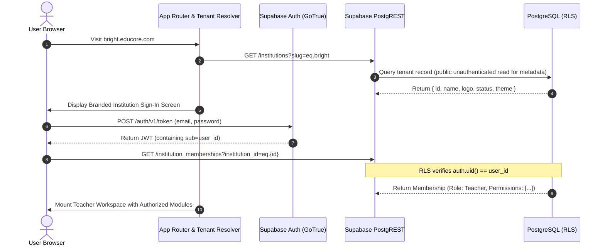
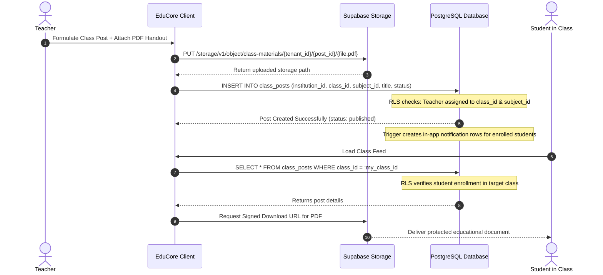
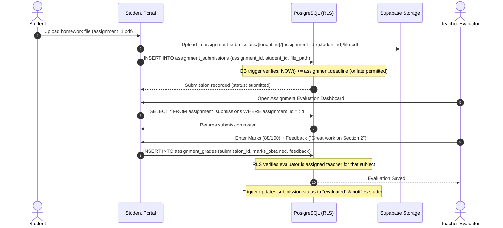

# EDUCORE — System Architecture & Technical Design Document
## Multi-Tenant Cloud Architecture, Subdomain Routing & Service Topology

---

## 1. System Topology & Infrastructure Overview

EduCore is engineered as a modern, decoupled, multi-tenant SaaS architecture combining a high-performance Single Page Application (SPA) frontend with an enterprise-grade Supabase / PostgreSQL backend.

```
                             [ Client Web Browsers ]
                                       │
                                       ▼
                  [ Cloudflare Edge Network / Anycast DNS ]
                      ├── Wildcard SSL (*.educore.com)
                      ├── DDoS Protection & WAF Rules
                      └── Edge Routing / Static Asset CDN
                                       │
                   ┌───────────────────┴───────────────────┐
                   ▼                                       ▼
      [ EduCore Vite SPA Client ]             [ Supabase Cloud / Kong Gateway ]
      ├── Subdomain Extraction Engine         ├── API Gateway & Rate Limiting
      ├── Tenant Context Provider             ├── PostgREST Engine (Auto REST)
      ├── Role-Based Dynamic Routing          ├── GoTrue (Supabase Auth)
      └── TanStack Query Cache                ├── Realtime Engine (WebSockets)
                                              └── Storage Engine (S3 Compatible)
                                                           │
                                                           ▼
                                            [ Managed PostgreSQL Database ]
                                              ├── Row Level Security (RLS)
                                              ├── Tenant-Partitioned Logic
                                              ├── Functions & Triggers
                                              └── Asynchronous Work Queues
                                                           │
                                   ┌───────────────────────┴───────────────────────┐
                                   ▼                                               ▼
                     [ Supabase Edge Functions ]                      [ External Services ]
                     ├── Payment Webhooks (Razorpay)                  ├── Resend (Transactional Email)
                     ├── Live Class Tokens (Zoom/Jitsi)               ├── Web Push Services
                     └── Scheduled Maintenance Crons                  └── Object Storage Mirror
```

---

## 2. Multi-Tenant Subdomain Resolution & Routing Engine

### 2.1 Subdomain Hostname Extraction
EduCore resolves tenant identity through the HTTP Host header using an intelligent resolution pipeline that supports local development, staging environments, and production wildcard subdomains.

```
Production Host:        bright.educore.com       ==>  Subdomain: "bright"
Staging Host:           bright.stage.educore.com ==>  Subdomain: "bright"
Localhost Development:  bright.lvh.me:5173       ==>  Subdomain: "bright"
Root Platform:          educore.com              ==>  Subdomain: null (Platform Home)
Admin Subdomain:        admin.educore.com        ==>  Subdomain: "admin" (Founder Portal)
```

### 2.2 Reserved Subdomain Blacklist
To prevent namespace collision, brand impersonation, and routing security vulnerabilities, the following subdomains are strictly reserved and prohibited from institutional registration:
```
Reserved List = [
  "www", "admin", "api", "app", "auth", "billing", "blog", "cdn",
  "dashboard", "dev", "docs", "email", "help", "hub", "internal",
  "login", "mail", "portal", "root", "secure", "signup", "stage",
  "staging", "status", "support", "test", "web", "webhook", "ws"
]
```

### 2.3 Tenant Resolution Lifecycle & Fallback State Machine



### 2.4 Fundamental Multi-Tenant Security Invariant
> [!CAUTION]
> **A subdomain is strictly a UI routing convenience, never an authorization boundary.**
> An attacker can forge Host headers, tamper with browser storage, or invoke API endpoints directly.
> Therefore:
> 1. The client-provided `institution_id` or subdomain is treated exclusively as an advisory search key.
> 2. The PostgreSQL database verifies that the authenticated user (`auth.uid()`) possesses an active membership record in `institution_memberships` for that specific `institution_id`.
> 3. Every row-level operation is enforced by PostgreSQL RLS policies that evaluate real JWT claims and database membership records.

---

## 3. Application Architecture & Clean Directory Structure

EduCore adopts a domain-driven, feature-first modular structure in React + TypeScript.

```
d:\Buildathon\Portal\
├── docs/                               # Comprehensive System Documentation
│   ├── 01_PROJECT_REQUIREMENTS.md
│   ├── 02_SYSTEM_ARCHITECTURE.md
│   ├── 03_ROLES_AND_PERMISSIONS_MATRIX.md
│   ├── 04_DATABASE_SCHEMA_AND_RLS.md
│   ├── 05_PROJECT_PLAN_AND_PHASES.md
│   └── 06_SECURITY_AND_TESTING_STRATEGY.md
├── src/
│   ├── app/                            # Global App Setup & Providers
│   │   ├── router/                     # React Router 7 / v6 Route Definitions
│   │   ├── providers/                  # React Query, Theme, Tenant, Auth Providers
│   │   └── App.tsx                     # Main Root Component
│   ├── assets/                         # Static Assets, Icons, Fonts
│   ├── components/                     # Shared UI Components
│   │   ├── ui/                         # shadcn/ui Base Atoms (Button, Input, Dialog, etc.)
│   │   ├── feedback/                   # Error Boundaries, Empty States, Skeletons
│   │   ├── navigation/                 # App Sidebar, Header, Mobile Drawer
│   │   └── data-display/               # DataTable, StatCard, Badge, PageHeader
│   ├── features/                       # Domain-Driven Functional Modules
│   │   ├── auth/                       # Sign In, Multi-Factor Auth, Password Recovery
│   │   ├── platform-admin/             # Founder Dashboard, Tenant Provisioning
│   │   ├── institution-admin/          # Tenant Settings, Manager Delegation
│   │   ├── academics/                  # Years, Grades/Sections, Courses/Batches, Subjects
│   │   ├── students/                   # SIS Directory, Admissions, Profiles
│   │   ├── teachers/                   # Faculty Directory, Subject/Class Allocations
│   │   ├── class-posts/                # Digital Noticeboard, Content Sharing, Learning Notes
│   │   ├── assignments/                # Assignment Creation, Submissions, Grading View
│   │   ├── live-classes/               # Virtual Sessions, Video Integration, Attendance
│   │   ├── attendance/                 # Daily & Subject-wise Registers, Analytics
│   │   ├── examinations/               # Exams, Marks Entry, Grade Book, Report Cards
│   │   ├── fees/                       # Fee Structures, Invoices, Payment Ledger
│   │   └── communications/             # Announcements, Notifications Center
│   ├── hooks/                          # Reusable Global Hooks
│   │   ├── use-tenant.ts               # Current Tenant Context & Feature Flags
│   │   ├── use-permission.ts           # Fine-Grained Permission Evaluator
│   │   └── use-media-query.ts          # Responsive Breakpoints
│   ├── integrations/                   # External Provider Clients
│   │   ├── supabase/                   # Supabase Client Instance & Typed Definitions
│   │   ├── video/                      # Zoom / Jitsi Provider Contracts
│   │   └── payment/                    # Razorpay / Stripe SDK Adapters
│   ├── lib/                            # Utilities, Formatters, Constants
│   │   ├── utils.ts                    # ClassNames (cn) Merger
│   │   ├── currency.ts                 # Minor Unit (Paise) Conversion Utilities
│   │   └── date.ts                     # Timezone-Aware Date Formatters
│   ├── schemas/                        # Zod Runtime Validation Schemas
│   └── types/                          # Global TypeScript Domain Definitions
│       ├── database.types.ts           # Auto-generated Supabase Schema Types
│       ├── tenant.ts                   # Tenant & Domain Models
│       └── permissions.ts              # Permission Keys & Role Enums
```

---

## 4. End-to-End Data Flow Architectures

### 4.1 Authentication & Tenant Context Initialization



### 4.2 Content Publishing & Learning Material Access



### 4.3 Assignment Submission & Evaluation Pipeline



---

## 5. Storage Architecture & Access Policies

Supabase Storage is partitioned into segregated buckets matching data sensitivity levels:

| Bucket Name | Privacy Level | Purpose | Max Size | Allowed MIME Types | Access Policy |
| :--- | :--- | :--- | :--- | :--- | :--- |
| `institution-assets` | Public | Logos, school banners, public badges | 5 MB | `image/png`, `image/jpeg`, `image/webp`, `image/svg+xml` | Public read; Write restricted to Tenant Admin. |
| `class-materials` | Authenticated (Tenant Protected) | Lecture notes, syllabus documents, worksheets, slides | 50 MB | `application/pdf`, `image/*`, `application/vnd.ms-powerpoint`, `text/*` | Read allowed only to enrolled students, teachers & admins of that tenant. |
| `assignment-submissions` | Private | Student homework, exam answer sheets | 25 MB | `application/pdf`, `image/*`, `application/zip` | Read restricted to the submitting student, their linked guardians, and assigned evaluating teachers. |
| `financial-receipts` | Private | PDF fee receipts, billing statements | 10 MB | `application/pdf` | Read restricted to the paying parent/student and finance managers/admins. |

### Storage Path Scheme
Every object uploaded to Supabase Storage follows a mandatory deterministic prefix convention:
```
/{bucket_name}/{institution_id}/{module_name}/{entity_id}/{uuid_filename}.{ext}
```
*Example:*
`/assignment-submissions/0192e85a-0000-7000-8000-000000000001/chem-lab-1/student_55/submission_v1.pdf`

---

## 6. Agnostic External Integration Contracts

### 6.1 Virtual Live Class Provider Abstraction
To avoid vendor lock-in, live class scheduling communicates through a unified TypeScript interface:

```typescript
export interface LiveClassProvider {
  createMeeting(params: CreateMeetingParams): Promise<MeetingResult>;
  cancelMeeting(meetingId: string): Promise<boolean>;
  getJoinUrl(meetingId: string, user: MeetingParticipant): Promise<string>;
  getRecordingMetadata?(meetingId: string): Promise<RecordingMetadata | null>;
}

export interface CreateMeetingParams {
  institutionId: string;
  topic: string;
  startTime: Date;
  durationMinutes: number;
  hostEmail: string;
}

export interface MeetingResult {
  provider: 'zoom' | 'google_meet' | 'jitsi' | 'teams';
  externalMeetingId: string;
  hostUrl: string;       // Preserved in private table; NEVER exposed to students
  encryptedJoinSecret: string;
  passcode?: string;
}
```

### 6.2 Payment Gateway Idempotent Webhook Architecture
Payments rely on asynchronous webhook confirmation rather than frontend redirects:
1. Student/Parent initiates payment &rarr; Server creates an Order in Razorpay with a unique transaction ID.
2. User completes payment on checkout widget &rarr; Gateway sends raw webhook payload to Supabase Edge Function `/payment-webhook`.
3. Edge Function verifies HMAC SHA-256 signature using the institution's or platform's webhook secret.
4. Payload is written to an idempotent `payment_webhook_events` table with unique constraint on `(gateway, event_id)`.
5. Database transaction updates invoice balance, creates payment record, and marks fee installment as cleared.
