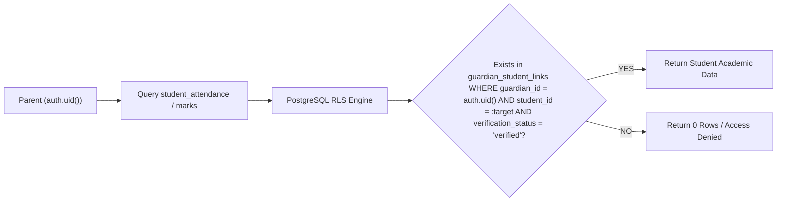

# EDUCORE — Roles, Authorisation & Permission Matrix
## Granular RBAC, Delegated Manager Scopes & Security Boundaries

---

## 1. Dual-Tier Administration Model

EduCore enforces a strict separation between the **Global Platform Tier** and the **Institution Tier**.

```
┌────────────────────────────────────────────────────────────────────────┐
│                   TIER 1: GLOBAL PLATFORM LEVEL                        │
│                                                                        │
│  [ Platform Founder / Super Admin ]                                    │
│   ├── Tenant Onboarding & Suspension                                   │
│   ├── Platform-wide Feature Gates & Quotas                             │
│   ├── Subscription Tiers & Billing Engine                              │
│   └── Global Telemetry & Cross-Tenant Security Audit                   │
└───────────────────────────────────┬────────────────────────────────────┘
                                    │ Governs Tenants
                                    ▼
┌────────────────────────────────────────────────────────────────────────┐
│                   TIER 2: TENANT / INSTITUTION LEVEL                   │
│                                                                        │
│  [ Institution Admin (Owner) ] ── Has Full Authority Within Tenant     │
│       │                                                                │
│       ├── Delegates Specific Modules & Actions                         │
│       ▼                                                                │
│  [ Manager (Configurable Operations) ] ── Strictly Scoped Permissions  │
│       │                                                                │
│       ├── Academic Execution & Instruction                             │
│       ▼                                                                │
│  [ Teacher / Faculty ] ── Assigned Classes & Subjects Only            │
│       │                                                                │
│       ├── Academic Participation & Learning                            │
│       ▼                                                                │
│  [ Student / Learner ] ── Own Submissions & Enrolled Classes Only      │
│       ▲                                                                │
│       └── Monitored by Verified Link                                   │
│  [ Parent / Guardian ] ── Verified Children's Records Only             │
└────────────────────────────────────────────────────────────────────────┘
```

---

## 2. Definitive Role Definitions & Scopes

### 1. Platform Founder / Super Admin
- **Scope:** Global ecosystem across all registered tenants.
- **Access Boundary:** Full authority over platform configuration, subscription tiers, tenant lifecycles, and global feature flags.
- **Privacy Rule:** Does *not* have routine access to student personal information, grades, or private classroom chat. Support inspection requires audited break-glass authorization.

### 2. Institution Admin (Tenant Owner)
- **Scope:** Entire institution boundaries (`institution_id`).
- **Access Boundary:** Unrestricted configuration within their tenant. Can invite staff, define academic structures, manage billing, configure tenant modules, and create managers.
- **Constraint:** Cannot access or modify data belonging to another tenant or alter global platform rules.

### 3. Manager (Delegated Operational Administrator)
- **Scope:** Configurable subset of modules within the institution.
- **Access Boundary:** *Zero default administrative privileges.* A newly created manager has no access until the Institution Admin explicitly toggles authorized permission keys (e.g., Attendance + Class Posting only, or Fees + Financial Reports only).
- **Hard Guardrails:**
  - Cannot create or modify other managers.
  - Cannot elevate their own role or assign permissions they do not possess.
  - Cannot modify institution ownership, payment gateway credentials, or subscription plans.

### 4. Teacher / Faculty
- **Scope:** Assigned academic classes, batches, and subjects (`teacher_assignments`).
- **Access Boundary:** Can create class posts, publish assignments, grade student work, record attendance, and host live classes for assigned groups.
- **Constraint:** Cannot view unrelated classes, faculty salary/fee structures, or alter institutional academic configurations.

### 5. Student / Learner
- **Scope:** Personal academic profile and actively enrolled cohorts (`student_enrollments`).
- **Access Boundary:** Read published learning materials, submit homework, view personal evaluation feedback and grades, check personal attendance records, and join scheduled live classes.
- **Constraint:** Zero access to un-enrolled cohorts, peer submissions, or internal teacher grading notes.

### 6. Parent / Guardian
- **Scope:** Verified linked children (`guardian_student_links`).
- **Access Boundary:** View attendance summaries, check published marks, view outstanding fee invoices, pay fees online, and read institutional announcements.
- **Constraint:** Access is established exclusively through administrator-verified relationships; guessing a student registration ID returns zero data.

---

## 3. Granular Permission Key Catalog

Every institutional operation is mapped to a namespaced permission token:

```
Platform Governance
  platform.tenants.view
  platform.tenants.create
  platform.tenants.manage_status   (suspend / reactivate)
  platform.features.manage_global  (toggle platform-wide modules)
  platform.billing.manage_plans

Institution Administration
  institution.profile.manage
  institution.settings.manage
  institution.branding.manage
  institution.modules.configure

Academic Hierarchy
  academics.years.manage
  academics.classes.create
  academics.classes.edit
  academics.classes.delete
  academics.subjects.manage
  academics.allocations.manage     (assign teachers to cohorts)

Student Information System (SIS)
  students.view_list
  students.view_sensitive_profile  (medical, address, emergency info)
  students.create
  students.edit
  students.delete
  students.bulk_import
  students.export_data

Teacher & Staff Management
  teachers.view_list
  teachers.create
  teachers.edit
  teachers.manage_status
  teachers.view_performance

Manager Delegation
  managers.view_list
  managers.create
  managers.edit_permissions
  managers.deactivate

Class Posting & Content
  class_posts.view
  class_posts.create
  class_posts.edit_own
  class_posts.edit_any
  class_posts.publish
  class_posts.pin
  class_posts.delete

Assignment Workflow
  assignments.view
  assignments.create
  assignments.edit
  assignments.publish
  assignments.delete
  assignments.grade
  assignments.view_submissions
  assignments.return_correction

Live Virtual Classes
  live_classes.view
  live_classes.schedule
  live_classes.host
  live_classes.cancel

Attendance Operations
  attendance.view_summary
  attendance.view_details
  attendance.record
  attendance.correct_past_records

Examinations & Results
  exams.create
  exams.edit
  exams.record_marks
  exams.verify_marks
  exams.publish_results
  exams.generate_report_cards

Fees & Financial Ledger
  fees.view_summary
  fees.manage_structures
  fees.assign_student_fee
  fees.collect_payment
  fees.apply_discount
  fees.process_refund
  fees.export_ledger

Communications & Announcements
  communications.announce_institution
  communications.announce_class
  communications.send_direct_message
  communications.manage_templates
```

---

## 4. Comprehensive Role & Permission Matrix

Legend:
- **`FULL`**: Unrestricted access across the institution.
- **`ASSIGN`**: Access restricted strictly to assigned classes/subjects.
- **`OWN`**: Access restricted strictly to own personal records or linked children.
- **`OPT`**: Optional privilege that can be delegated to Managers by the Institution Admin.
- **`DENIED`**: Operation strictly prohibited by RLS and application policy.

| Permission Key | Founder | Inst Admin | Manager | Teacher | Student | Parent |
| :--- | :---: | :---: | :---: | :---: | :---: | :---: |
| **Institution Configuration** | | | | | | |
| `institution.profile.manage` | `FULL` | `FULL` | `DENIED` | `DENIED` | `DENIED` | `DENIED` |
| `institution.modules.configure` | `FULL` | `FULL` | `DENIED` | `DENIED` | `DENIED` | `DENIED` |
| **Manager Delegation** | | | | | | |
| `managers.create` | `DENIED` | `FULL` | `DENIED` | `DENIED` | `DENIED` | `DENIED` |
| `managers.edit_permissions` | `DENIED` | `FULL` | `DENIED` | `DENIED` | `DENIED` | `DENIED` |
| **Academic Hierarchy** | | | | | | |
| `academics.years.manage` | `DENIED` | `FULL` | `OPT` | `DENIED` | `DENIED` | `DENIED` |
| `academics.classes.create` | `DENIED` | `FULL` | `OPT` | `DENIED` | `DENIED` | `DENIED` |
| `academics.allocations.manage`| `DENIED` | `FULL` | `OPT` | `DENIED` | `DENIED` | `DENIED` |
| **Student Management** | | | | | | |
| `students.create` | `DENIED` | `FULL` | `OPT` | `DENIED` | `DENIED` | `DENIED` |
| `students.view_list` | `DENIED` | `FULL` | `OPT` | `ASSIGN` | `DENIED` | `DENIED` |
| `students.view_sensitive_profile` | `DENIED` | `FULL` | `OPT` | `DENIED` | `OWN` | `OWN` |
| **Teacher Management** | | | | | | |
| `teachers.create` | `DENIED` | `FULL` | `OPT` | `DENIED` | `DENIED` | `DENIED` |
| `teachers.view_list` | `DENIED` | `FULL` | `OPT` | `FULL` | `ASSIGN` | `ASSIGN` |
| **Class Posting** | | | | | | |
| `class_posts.create` | `DENIED` | `FULL` | `OPT` | `ASSIGN` | `DENIED` | `DENIED` |
| `class_posts.view` | `DENIED` | `FULL` | `OPT` | `ASSIGN` | `ASSIGN` | `ASSIGN` |
| `class_posts.pin` | `DENIED` | `FULL` | `OPT` | `ASSIGN` | `DENIED` | `DENIED` |
| **Assignments & Grading** | | | | | | |
| `assignments.create` | `DENIED` | `FULL` | `OPT` | `ASSIGN` | `DENIED` | `DENIED` |
| `assignments.view` | `DENIED` | `FULL` | `OPT` | `ASSIGN` | `ASSIGN` | `ASSIGN` |
| `assignments.submit` | `DENIED` | `DENIED`| `DENIED`| `DENIED` | `OWN` | `DENIED` |
| `assignments.grade` | `DENIED` | `FULL` | `OPT` | `ASSIGN` | `DENIED` | `DENIED` |
| **Live Virtual Classes** | | | | | | |
| `live_classes.schedule` | `DENIED` | `FULL` | `OPT` | `ASSIGN` | `DENIED` | `DENIED` |
| `live_classes.host` | `DENIED` | `FULL` | `OPT` | `ASSIGN` | `DENIED` | `DENIED` |
| `live_classes.join` | `DENIED` | `FULL` | `OPT` | `ASSIGN` | `ASSIGN` | `DENIED` |
| **Attendance Operations** | | | | | | |
| `attendance.record` | `DENIED` | `FULL` | `OPT` | `ASSIGN` | `DENIED` | `DENIED` |
| `attendance.view_summary` | `DENIED` | `FULL` | `OPT` | `ASSIGN` | `OWN` | `OWN` |
| `attendance.correct_past_records` | `DENIED` | `FULL` | `OPT` | `DENIED` | `DENIED` | `DENIED` |
| **Examinations & Results** | | | | | | |
| `exams.create` | `DENIED` | `FULL` | `OPT` | `DENIED` | `DENIED` | `DENIED` |
| `exams.record_marks` | `DENIED` | `FULL` | `OPT` | `ASSIGN` | `DENIED` | `DENIED` |
| `exams.publish_results` | `DENIED` | `FULL` | `OPT` | `DENIED` | `DENIED` | `DENIED` |
| `exams.view_results` | `DENIED` | `FULL` | `OPT` | `ASSIGN` | `OWN` | `OWN` |
| **Fees & Payments** | | | | | | |
| `fees.manage_structures` | `DENIED` | `FULL` | `OPT` | `DENIED` | `DENIED` | `DENIED` |
| `fees.collect_payment` | `DENIED` | `FULL` | `OPT` | `DENIED` | `DENIED` | `DENIED` |
| `fees.view_student_ledger` | `DENIED` | `FULL` | `OPT` | `DENIED` | `OWN` | `OWN` |
| `fees.pay_online` | `DENIED` | `DENIED`| `DENIED`| `DENIED` | `OWN` | `OWN` |
| **Communications** | | | | | | |
| `communications.announce_institution` | `DENIED` | `FULL` | `OPT` | `DENIED` | `DENIED` | `DENIED` |
| `communications.announce_class` | `DENIED` | `FULL` | `OPT` | `ASSIGN` | `DENIED` | `DENIED` |

---

## 5. Dynamic Manager Permission Delegation Architecture

To accommodate varying organizational scales (from small tuition centers with 1 manager to multi-campus academies with 20 specialized supervisors), manager privileges are dynamically evaluated at runtime.

### Data Schema Representation
```sql
-- Manager specific permission overrides
CREATE TABLE member_permission_overrides (
    id UUID PRIMARY KEY DEFAULT gen_random_uuid(),
    institution_id UUID NOT NULL REFERENCES institutions(id) ON DELETE CASCADE,
    membership_id UUID NOT NULL REFERENCES institution_memberships(id) ON DELETE CASCADE,
    permission_key VARCHAR(100) NOT NULL REFERENCES institution_permissions(key),
    is_granted BOOLEAN NOT NULL DEFAULT true,
    granted_by UUID NOT NULL REFERENCES auth.users(id),
    created_at TIMESTAMPTZ NOT NULL DEFAULT timezone('utc', now()),
    UNIQUE(membership_id, permission_key)
);
```

### PostgreSQL Authorization Evaluation Function
```sql
CREATE OR REPLACE FUNCTION has_tenant_permission(
    target_institution_id UUID,
    required_permission VARCHAR(100)
) RETURNS BOOLEAN AS $$
DECLARE
    user_role VARCHAR(50);
    user_membership_id UUID;
    has_override BOOLEAN;
    is_role_permitted BOOLEAN;
BEGIN
    -- 1. Resolve membership and role for authenticated user
    SELECT id, role INTO user_membership_id, user_role
    FROM institution_memberships
    WHERE institution_id = target_institution_id
      AND user_id = auth.uid()
      AND status = 'active';

    IF NOT FOUND THEN
        RETURN FALSE;
    END IF;

    -- 2. Institution Admin has absolute internal authority
    IF user_role = 'institution_admin' THEN
        RETURN TRUE;
    END IF;

    -- 3. Check individual overrides first (explicit grant or revocation)
    SELECT is_granted INTO has_override
    FROM member_permission_overrides
    WHERE membership_id = user_membership_id
      AND permission_key = required_permission;

    IF FOUND THEN
        RETURN has_override;
    END IF;

    -- 4. Fall back to base role permissions
    SELECT EXISTS (
        SELECT 1 
        FROM role_permissions rp
        JOIN institution_roles r ON rp.role_id = r.id
        WHERE r.code = user_role
          AND rp.permission_key = required_permission
    ) INTO is_role_permitted;

    RETURN COALESCE(is_role_permitted, FALSE);
END;
$$ LANGUAGE plpgsql SECURITY DEFINER STABLE;
```

---

## 6. Parent-Child Relationship Verification & Anti-IDOR Model

### 6.1 Vulnerability Scenario (Insecure Direct Object Reference)
In naive implementations, a parent submits `/api/student/104/grades`. If the backend only checks "Is the caller a Parent?", any parent can scrape grades of all students by incrementing IDs.

### 6.2 EduCore Defense Invariant
EduCore mandates that any access to student data by a parent must prove an explicit, institution-approved row in `guardian_student_links`:


