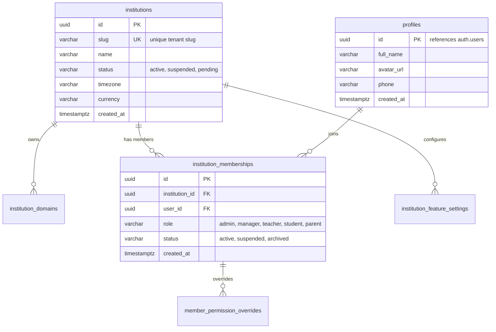
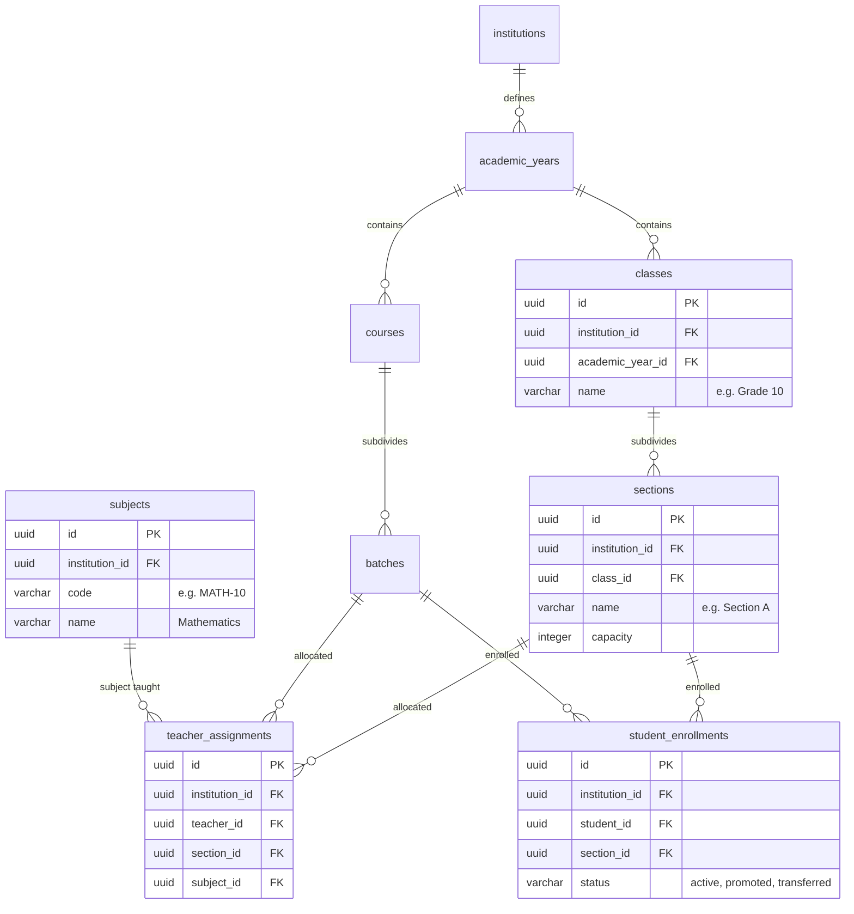
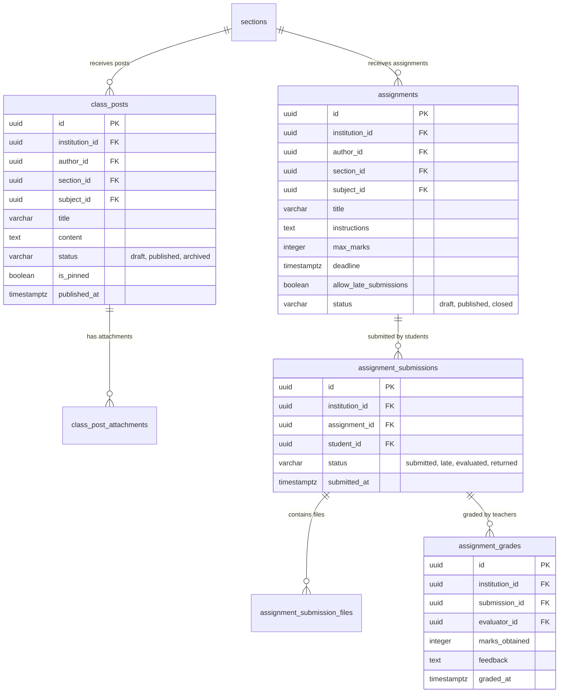

# EDUCORE — Production PostgreSQL Schema & RLS Architecture
## Multi-Tenant Database Design, Entity-Relationship Models & Security Policies

---

## 1. Database Architecture Principles

1. **Tenant Fencing via Composite Foreign Keys:**
   To guarantee that a child entity in Institution A cannot accidentally link to a parent entity in Institution B, critical relationships use composite uniqueness and composite foreign keys:
   `UNIQUE(institution_id, id)` &rarr; `FOREIGN KEY (institution_id, parent_id) REFERENCES parent_table(institution_id, id)`.
2. **Deterministic Minor Unit Currency:**
   All monetary amounts are stored as 64-bit signed integers (`BIGINT`) representing minor units (paise in INR, cents in USD). Floating-point `NUMERIC` or `FLOAT` types are strictly prohibited for monetary balances.
3. **UTC Timestamps Everywhere:**
   Every timestamp column uses `TIMESTAMPTZ` with `DEFAULT timezone('utc', now())`. Timezone display conversion is handled in the UI presentation layer based on the institution's configured `timezone`.
4. **Mandatory Row Level Security:**
   Every table residing in the `public` schema has Row Level Security strictly enabled (`ALTER TABLE ... ENABLE ROW LEVEL SECURITY; ALTER TABLE ... FORCE ROW LEVEL SECURITY;`).
5. **No Service Key in Frontend:**
   Queries rely on standard authenticated JWT sessions (`auth.uid()`). All RLS policies verify membership and explicit role privileges.

---

## 2. Entity-Relationship Diagrams (ERD)

### 2.1 Core Platform & Multi-Tenant Membership Model



### 2.2 Academic Hierarchy & User Allocations Model



### 2.3 Learning, Content & Assignments Model



---

## 3. Production PostgreSQL DDL Specification

Below is the complete, production-grade schema definition for EduCore.

```sql
-- Enable necessary PostgreSQL extensions
CREATE EXTENSION IF NOT EXISTS "uuid-ossp";
CREATE EXTENSION IF NOT EXISTS "pgcrypto";

-- ============================================================================
-- 1. PROFILES (Extends auth.users)
-- ============================================================================
CREATE TABLE profiles (
    id UUID PRIMARY KEY REFERENCES auth.users(id) ON DELETE CASCADE,
    full_name VARCHAR(150) NOT NULL,
    avatar_url TEXT,
    phone_number VARCHAR(25),
    is_platform_founder BOOLEAN NOT NULL DEFAULT false,
    created_at TIMESTAMPTZ NOT NULL DEFAULT timezone('utc', now()),
    updated_at TIMESTAMPTZ NOT NULL DEFAULT timezone('utc', now())
);

-- ============================================================================
-- 2. INSTITUTIONS (Tenants)
-- ============================================================================
CREATE TABLE institutions (
    id UUID PRIMARY KEY DEFAULT gen_random_uuid(),
    slug VARCHAR(63) NOT NULL UNIQUE,
    name VARCHAR(200) NOT NULL,
    institution_type VARCHAR(50) NOT NULL CHECK (institution_type IN ('school', 'tuition_centre', 'coaching_institute', 'academy', 'college')),
    status VARCHAR(30) NOT NULL DEFAULT 'active' CHECK (status IN ('pending_verification', 'active', 'suspended', 'archived')),
    logo_url TEXT,
    favicon_url TEXT,
    primary_color VARCHAR(10) DEFAULT '#2563eb',
    timezone VARCHAR(50) NOT NULL DEFAULT 'Asia/Kolkata',
    currency VARCHAR(3) NOT NULL DEFAULT 'INR',
    contact_email VARCHAR(255) NOT NULL,
    contact_phone VARCHAR(25),
    address TEXT,
    created_at TIMESTAMPTZ NOT NULL DEFAULT timezone('utc', now()),
    updated_at TIMESTAMPTZ NOT NULL DEFAULT timezone('utc', now()),
    CONSTRAINT chk_slug_format CHECK (slug ~* '^[a-z0-9][a-z0-9-]{1,61}[a-z0-9]$')
);

CREATE INDEX idx_institutions_slug ON institutions(slug);
CREATE INDEX idx_institutions_status ON institutions(status);

-- ============================================================================
-- 3. INSTITUTION MEMBERSHIPS & PERMISSIONS
-- ============================================================================
CREATE TABLE institution_memberships (
    id UUID PRIMARY KEY DEFAULT gen_random_uuid(),
    institution_id UUID NOT NULL REFERENCES institutions(id) ON DELETE CASCADE,
    user_id UUID NOT NULL REFERENCES auth.users(id) ON DELETE CASCADE,
    role VARCHAR(30) NOT NULL CHECK (role IN ('institution_admin', 'manager', 'teacher', 'student', 'parent')),
    status VARCHAR(20) NOT NULL DEFAULT 'active' CHECK (status IN ('active', 'invited', 'suspended', 'archived')),
    created_at TIMESTAMPTZ NOT NULL DEFAULT timezone('utc', now()),
    updated_at TIMESTAMPTZ NOT NULL DEFAULT timezone('utc', now()),
    UNIQUE (institution_id, user_id),
    UNIQUE (institution_id, id) -- Composite key for tenant-safe FK references
);

CREATE INDEX idx_memberships_inst_user ON institution_memberships(institution_id, user_id);
CREATE INDEX idx_memberships_role ON institution_memberships(institution_id, role);

CREATE TABLE institution_permissions (
    key VARCHAR(100) PRIMARY KEY,
    module VARCHAR(50) NOT NULL,
    description TEXT NOT NULL
);

CREATE TABLE member_permission_overrides (
    id UUID PRIMARY KEY DEFAULT gen_random_uuid(),
    institution_id UUID NOT NULL REFERENCES institutions(id) ON DELETE CASCADE,
    membership_id UUID NOT NULL REFERENCES institution_memberships(id) ON DELETE CASCADE,
    permission_key VARCHAR(100) NOT NULL REFERENCES institution_permissions(key),
    is_granted BOOLEAN NOT NULL DEFAULT true,
    granted_by UUID NOT NULL REFERENCES auth.users(id),
    created_at TIMESTAMPTZ NOT NULL DEFAULT timezone('utc', now()),
    UNIQUE (membership_id, permission_key)
);

-- ============================================================================
-- 4. GUARDIAN-STUDENT RELATIONSHIPS
-- ============================================================================
CREATE TABLE guardian_student_links (
    id UUID PRIMARY KEY DEFAULT gen_random_uuid(),
    institution_id UUID NOT NULL REFERENCES institutions(id) ON DELETE CASCADE,
    guardian_membership_id UUID NOT NULL REFERENCES institution_memberships(id) ON DELETE CASCADE,
    student_membership_id UUID NOT NULL REFERENCES institution_memberships(id) ON DELETE CASCADE,
    relationship_type VARCHAR(30) NOT NULL CHECK (relationship_type IN ('father', 'mother', 'legal_guardian', 'sponsor', 'other')),
    is_emergency_contact BOOLEAN NOT NULL DEFAULT false,
    verification_status VARCHAR(20) NOT NULL DEFAULT 'verified' CHECK (verification_status IN ('pending', 'verified', 'revoked')),
    created_at TIMESTAMPTZ NOT NULL DEFAULT timezone('utc', now()),
    UNIQUE(institution_id, guardian_membership_id, student_membership_id)
);

CREATE INDEX idx_guardian_links_lookup ON guardian_student_links(institution_id, guardian_membership_id);

-- ============================================================================
-- 5. ACADEMIC STRUCTURE (Hybrid: K-12 & Coaching/Tuition)
-- ============================================================================
CREATE TABLE academic_years (
    id UUID PRIMARY KEY DEFAULT gen_random_uuid(),
    institution_id UUID NOT NULL REFERENCES institutions(id) ON DELETE CASCADE,
    name VARCHAR(100) NOT NULL, -- e.g. "2026-2027" or "Session 2026"
    start_date DATE NOT NULL,
    end_date DATE NOT NULL,
    is_current BOOLEAN NOT NULL DEFAULT false,
    created_at TIMESTAMPTZ NOT NULL DEFAULT timezone('utc', now()),
    UNIQUE(institution_id, name),
    UNIQUE(institution_id, id),
    CONSTRAINT chk_academic_dates CHECK (end_date > start_date)
);

-- School Structure: Classes & Sections
CREATE TABLE classes (
    id UUID PRIMARY KEY DEFAULT gen_random_uuid(),
    institution_id UUID NOT NULL REFERENCES institutions(id) ON DELETE CASCADE,
    academic_year_id UUID NOT NULL,
    name VARCHAR(100) NOT NULL, -- e.g. "Grade 10", "Class XII"
    display_order INT DEFAULT 0,
    created_at TIMESTAMPTZ NOT NULL DEFAULT timezone('utc', now()),
    UNIQUE(institution_id, id),
    FOREIGN KEY (institution_id, academic_year_id) REFERENCES academic_years(institution_id, id) ON DELETE CASCADE
);

CREATE TABLE sections (
    id UUID PRIMARY KEY DEFAULT gen_random_uuid(),
    institution_id UUID NOT NULL REFERENCES institutions(id) ON DELETE CASCADE,
    class_id UUID NOT NULL,
    name VARCHAR(50) NOT NULL, -- e.g. "Section A", "Section Blue"
    capacity INT NOT NULL DEFAULT 40,
    created_at TIMESTAMPTZ NOT NULL DEFAULT timezone('utc', now()),
    UNIQUE(institution_id, id),
    UNIQUE(class_id, name),
    FOREIGN KEY (institution_id, class_id) REFERENCES classes(institution_id, id) ON DELETE CASCADE
);

-- Tuition / Coaching Structure: Courses & Batches
CREATE TABLE courses (
    id UUID PRIMARY KEY DEFAULT gen_random_uuid(),
    institution_id UUID NOT NULL REFERENCES institutions(id) ON DELETE CASCADE,
    academic_year_id UUID NOT NULL,
    name VARCHAR(150) NOT NULL, -- e.g. "IIT-JEE Crash Course"
    code VARCHAR(50),
    created_at TIMESTAMPTZ NOT NULL DEFAULT timezone('utc', now()),
    UNIQUE(institution_id, id),
    FOREIGN KEY (institution_id, academic_year_id) REFERENCES academic_years(institution_id, id) ON DELETE CASCADE
);

CREATE TABLE batches (
    id UUID PRIMARY KEY DEFAULT gen_random_uuid(),
    institution_id UUID NOT NULL REFERENCES institutions(id) ON DELETE CASCADE,
    course_id UUID NOT NULL,
    name VARCHAR(100) NOT NULL, -- e.g. "Morning Alpha 2026"
    capacity INT NOT NULL DEFAULT 60,
    created_at TIMESTAMPTZ NOT NULL DEFAULT timezone('utc', now()),
    UNIQUE(institution_id, id),
    UNIQUE(course_id, name),
    FOREIGN KEY (institution_id, course_id) REFERENCES courses(institution_id, id) ON DELETE CASCADE
);

CREATE TABLE subjects (
    id UUID PRIMARY KEY DEFAULT gen_random_uuid(),
    institution_id UUID NOT NULL REFERENCES institutions(id) ON DELETE CASCADE,
    code VARCHAR(30) NOT NULL,
    name VARCHAR(150) NOT NULL,
    description TEXT,
    created_at TIMESTAMPTZ NOT NULL DEFAULT timezone('utc', now()),
    UNIQUE(institution_id, id),
    UNIQUE(institution_id, code)
);

CREATE TABLE teacher_assignments (
    id UUID PRIMARY KEY DEFAULT gen_random_uuid(),
    institution_id UUID NOT NULL REFERENCES institutions(id) ON DELETE CASCADE,
    teacher_membership_id UUID NOT NULL,
    subject_id UUID NOT NULL,
    section_id UUID, -- For school model
    batch_id UUID,   -- For tuition model
    created_at TIMESTAMPTZ NOT NULL DEFAULT timezone('utc', now()),
    FOREIGN KEY (institution_id, teacher_membership_id) REFERENCES institution_memberships(institution_id, id) ON DELETE CASCADE,
    FOREIGN KEY (institution_id, subject_id) REFERENCES subjects(institution_id, id) ON DELETE CASCADE,
    CONSTRAINT chk_cohort_target CHECK ((section_id IS NOT NULL AND batch_id IS NULL) OR (section_id IS NULL AND batch_id IS NOT NULL))
);

CREATE TABLE student_enrollments (
    id UUID PRIMARY KEY DEFAULT gen_random_uuid(),
    institution_id UUID NOT NULL REFERENCES institutions(id) ON DELETE CASCADE,
    student_membership_id UUID NOT NULL,
    section_id UUID,
    batch_id UUID,
    roll_number VARCHAR(50),
    status VARCHAR(20) NOT NULL DEFAULT 'enrolled' CHECK (status IN ('enrolled', 'promoted', 'graduated', 'transferred', 'withdrawn')),
    created_at TIMESTAMPTZ NOT NULL DEFAULT timezone('utc', now()),
    FOREIGN KEY (institution_id, student_membership_id) REFERENCES institution_memberships(institution_id, id) ON DELETE CASCADE,
    CONSTRAINT chk_enrollment_target CHECK ((section_id IS NOT NULL AND batch_id IS NULL) OR (section_id IS NULL AND batch_id IS NOT NULL))
);

CREATE INDEX idx_student_enrollments_student ON student_enrollments(institution_id, student_membership_id);

-- ============================================================================
-- 6. CLASS POSTING & LEARNING MATERIALS
-- ============================================================================
CREATE TABLE class_posts (
    id UUID PRIMARY KEY DEFAULT gen_random_uuid(),
    institution_id UUID NOT NULL REFERENCES institutions(id) ON DELETE CASCADE,
    author_id UUID NOT NULL REFERENCES auth.users(id),
    section_id UUID,
    batch_id UUID,
    subject_id UUID,
    title VARCHAR(255) NOT NULL,
    content TEXT NOT NULL,
    is_pinned BOOLEAN NOT NULL DEFAULT false,
    status VARCHAR(20) NOT NULL DEFAULT 'published' CHECK (status IN ('draft', 'scheduled', 'published', 'archived')),
    scheduled_for TIMESTAMPTZ,
    created_at TIMESTAMPTZ NOT NULL DEFAULT timezone('utc', now()),
    updated_at TIMESTAMPTZ NOT NULL DEFAULT timezone('utc', now()),
    FOREIGN KEY (institution_id, subject_id) REFERENCES subjects(institution_id, id) ON DELETE SET NULL,
    CONSTRAINT chk_post_cohort CHECK ((section_id IS NOT NULL AND batch_id IS NULL) OR (section_id IS NULL AND batch_id IS NOT NULL))
);

CREATE TABLE class_post_attachments (
    id UUID PRIMARY KEY DEFAULT gen_random_uuid(),
    institution_id UUID NOT NULL REFERENCES institutions(id) ON DELETE CASCADE,
    post_id UUID NOT NULL REFERENCES class_posts(id) ON DELETE CASCADE,
    file_name VARCHAR(255) NOT NULL,
    file_path TEXT NOT NULL,
    file_type VARCHAR(100) NOT NULL,
    file_size_bytes BIGINT NOT NULL,
    created_at TIMESTAMPTZ NOT NULL DEFAULT timezone('utc', now())
);

-- ============================================================================
-- 7. ASSIGNMENT MANAGEMENT
-- ============================================================================
CREATE TABLE assignments (
    id UUID PRIMARY KEY DEFAULT gen_random_uuid(),
    institution_id UUID NOT NULL REFERENCES institutions(id) ON DELETE CASCADE,
    author_id UUID NOT NULL REFERENCES auth.users(id),
    section_id UUID,
    batch_id UUID,
    subject_id UUID NOT NULL,
    title VARCHAR(255) NOT NULL,
    instructions TEXT NOT NULL,
    max_marks INT NOT NULL CHECK (max_marks > 0),
    deadline TIMESTAMPTZ NOT NULL,
    allow_late_submissions BOOLEAN NOT NULL DEFAULT false,
    status VARCHAR(20) NOT NULL DEFAULT 'published' CHECK (status IN ('draft', 'published', 'closed', 'cancelled')),
    created_at TIMESTAMPTZ NOT NULL DEFAULT timezone('utc', now()),
    updated_at TIMESTAMPTZ NOT NULL DEFAULT timezone('utc', now()),
    FOREIGN KEY (institution_id, subject_id) REFERENCES subjects(institution_id, id) ON DELETE RESTRICT,
    CONSTRAINT chk_assignment_cohort CHECK ((section_id IS NOT NULL AND batch_id IS NULL) OR (section_id IS NULL AND batch_id IS NOT NULL))
);

CREATE TABLE assignment_submissions (
    id UUID PRIMARY KEY DEFAULT gen_random_uuid(),
    institution_id UUID NOT NULL REFERENCES institutions(id) ON DELETE CASCADE,
    assignment_id UUID NOT NULL REFERENCES assignments(id) ON DELETE CASCADE,
    student_membership_id UUID NOT NULL,
    submission_text TEXT,
    status VARCHAR(30) NOT NULL DEFAULT 'submitted' CHECK (status IN ('submitted', 'late', 'under_review', 'evaluated', 'returned_for_correction')),
    submitted_at TIMESTAMPTZ NOT NULL DEFAULT timezone('utc', now()),
    UNIQUE(assignment_id, student_membership_id),
    FOREIGN KEY (institution_id, student_membership_id) REFERENCES institution_memberships(institution_id, id) ON DELETE CASCADE
);

CREATE TABLE assignment_submission_files (
    id UUID PRIMARY KEY DEFAULT gen_random_uuid(),
    institution_id UUID NOT NULL REFERENCES institutions(id) ON DELETE CASCADE,
    submission_id UUID NOT NULL REFERENCES assignment_submissions(id) ON DELETE CASCADE,
    file_name VARCHAR(255) NOT NULL,
    file_path TEXT NOT NULL,
    file_size_bytes BIGINT NOT NULL,
    created_at TIMESTAMPTZ NOT NULL DEFAULT timezone('utc', now())
);

CREATE TABLE assignment_grades (
    id UUID PRIMARY KEY DEFAULT gen_random_uuid(),
    institution_id UUID NOT NULL REFERENCES institutions(id) ON DELETE CASCADE,
    submission_id UUID NOT NULL UNIQUE REFERENCES assignment_submissions(id) ON DELETE CASCADE,
    evaluator_id UUID NOT NULL REFERENCES auth.users(id),
    marks_obtained NUMERIC(6, 2) NOT NULL CHECK (marks_obtained >= 0),
    feedback TEXT,
    graded_at TIMESTAMPTZ NOT NULL DEFAULT timezone('utc', now())
);

-- ============================================================================
-- 8. ATTENDANCE SYSTEM
-- ============================================================================
CREATE TABLE attendance_sessions (
    id UUID PRIMARY KEY DEFAULT gen_random_uuid(),
    institution_id UUID NOT NULL REFERENCES institutions(id) ON DELETE CASCADE,
    session_date DATE NOT NULL,
    section_id UUID,
    batch_id UUID,
    subject_id UUID, -- NULL for homeroom daily attendance, populated for subject period
    recorded_by UUID NOT NULL REFERENCES auth.users(id),
    created_at TIMESTAMPTZ NOT NULL DEFAULT timezone('utc', now()),
    UNIQUE(institution_id, session_date, section_id, batch_id, subject_id)
);

CREATE TABLE student_attendance (
    id UUID PRIMARY KEY DEFAULT gen_random_uuid(),
    institution_id UUID NOT NULL REFERENCES institutions(id) ON DELETE CASCADE,
    session_id UUID NOT NULL REFERENCES attendance_sessions(id) ON DELETE CASCADE,
    student_membership_id UUID NOT NULL,
    status VARCHAR(20) NOT NULL CHECK (status IN ('present', 'absent', 'late', 'excused', 'sick_leave')),
    remarks VARCHAR(255),
    created_at TIMESTAMPTZ NOT NULL DEFAULT timezone('utc', now()),
    updated_at TIMESTAMPTZ NOT NULL DEFAULT timezone('utc', now()),
    UNIQUE(session_id, student_membership_id),
    FOREIGN KEY (institution_id, student_membership_id) REFERENCES institution_memberships(institution_id, id) ON DELETE CASCADE
);

CREATE INDEX idx_student_attendance_student ON student_attendance(institution_id, student_membership_id);

-- ============================================================================
-- 9. FEES & FINANCIAL LEDGER (Minor Unit Paise)
-- ============================================================================
CREATE TABLE fee_categories (
    id UUID PRIMARY KEY DEFAULT gen_random_uuid(),
    institution_id UUID NOT NULL REFERENCES institutions(id) ON DELETE CASCADE,
    name VARCHAR(100) NOT NULL, -- e.g. "Tuition Fee", "Lab Fee", "Transportation"
    description TEXT,
    created_at TIMESTAMPTZ NOT NULL DEFAULT timezone('utc', now()),
    UNIQUE(institution_id, name)
);

CREATE TABLE fee_structures (
    id UUID PRIMARY KEY DEFAULT gen_random_uuid(),
    institution_id UUID NOT NULL REFERENCES institutions(id) ON DELETE CASCADE,
    academic_year_id UUID NOT NULL,
    fee_category_id UUID NOT NULL REFERENCES fee_categories(id) ON DELETE CASCADE,
    class_id UUID REFERENCES classes(id),
    course_id UUID REFERENCES courses(id),
    amount_in_paise BIGINT NOT NULL CHECK (amount_in_paise > 0),
    due_date DATE NOT NULL,
    created_at TIMESTAMPTZ NOT NULL DEFAULT timezone('utc', now())
);

CREATE TABLE student_invoices (
    id UUID PRIMARY KEY DEFAULT gen_random_uuid(),
    institution_id UUID NOT NULL REFERENCES institutions(id) ON DELETE CASCADE,
    invoice_number VARCHAR(60) NOT NULL,
    student_membership_id UUID NOT NULL,
    total_amount_in_paise BIGINT NOT NULL CHECK (total_amount_in_paise >= 0),
    discount_in_paise BIGINT NOT NULL DEFAULT 0 CHECK (discount_in_paise >= 0),
    paid_amount_in_paise BIGINT NOT NULL DEFAULT 0 CHECK (paid_amount_in_paise >= 0),
    due_date DATE NOT NULL,
    status VARCHAR(20) NOT NULL DEFAULT 'unpaid' CHECK (status IN ('unpaid', 'partially_paid', 'paid', 'cancelled', 'refunded')),
    created_at TIMESTAMPTZ NOT NULL DEFAULT timezone('utc', now()),
    updated_at TIMESTAMPTZ NOT NULL DEFAULT timezone('utc', now()),
    UNIQUE(institution_id, invoice_number),
    FOREIGN KEY (institution_id, student_membership_id) REFERENCES institution_memberships(institution_id, id) ON DELETE CASCADE
);

CREATE TABLE payments (
    id UUID PRIMARY KEY DEFAULT gen_random_uuid(),
    institution_id UUID NOT NULL REFERENCES institutions(id) ON DELETE CASCADE,
    invoice_id UUID NOT NULL REFERENCES student_invoices(id) ON DELETE RESTRICT,
    receipt_number VARCHAR(60) NOT NULL,
    amount_paid_in_paise BIGINT NOT NULL CHECK (amount_paid_in_paise > 0),
    payment_method VARCHAR(30) NOT NULL CHECK (payment_method IN ('cash', 'upi', 'credit_card', 'net_banking', 'cheque', 'bank_transfer')),
    gateway_transaction_id VARCHAR(100),
    payment_date TIMESTAMPTZ NOT NULL DEFAULT timezone('utc', now()),
    recorded_by UUID NOT NULL REFERENCES auth.users(id),
    notes TEXT,
    created_at TIMESTAMPTZ NOT NULL DEFAULT timezone('utc', now()),
    UNIQUE(institution_id, receipt_number)
);

CREATE INDEX idx_invoices_student ON student_invoices(institution_id, student_membership_id);
CREATE INDEX idx_payments_invoice ON payments(institution_id, invoice_id);

-- ============================================================================
-- 10. AUDIT LOGGING
-- ============================================================================
CREATE TABLE audit_logs (
    id UUID PRIMARY KEY DEFAULT gen_random_uuid(),
    institution_id UUID REFERENCES institutions(id) ON DELETE CASCADE,
    actor_id UUID REFERENCES auth.users(id),
    actor_role VARCHAR(50),
    action VARCHAR(100) NOT NULL, -- e.g. "attendance.record", "fees.collect_payment"
    entity_name VARCHAR(60) NOT NULL,
    entity_id UUID NOT NULL,
    old_data JSONB,
    new_data JSONB,
    ip_address INET,
    user_agent TEXT,
    created_at TIMESTAMPTZ NOT NULL DEFAULT timezone('utc', now())
);

CREATE INDEX idx_audit_logs_lookup ON audit_logs(institution_id, entity_name, entity_id);
```

---

## 4. Production Row Level Security (RLS) Implementation

```sql
-- Enable RLS across all tables
ALTER TABLE profiles ENABLE ROW LEVEL SECURITY;
ALTER TABLE institutions ENABLE ROW LEVEL SECURITY;
ALTER TABLE institution_memberships ENABLE ROW LEVEL SECURITY;
ALTER TABLE classes ENABLE ROW LEVEL SECURITY;
ALTER TABLE sections ENABLE ROW LEVEL SECURITY;
ALTER TABLE subjects ENABLE ROW LEVEL SECURITY;
ALTER TABLE teacher_assignments ENABLE ROW LEVEL SECURITY;
ALTER TABLE student_enrollments ENABLE ROW LEVEL SECURITY;
ALTER TABLE class_posts ENABLE ROW LEVEL SECURITY;
ALTER TABLE assignments ENABLE ROW LEVEL SECURITY;
ALTER TABLE assignment_submissions ENABLE ROW LEVEL SECURITY;
ALTER TABLE assignment_grades ENABLE ROW LEVEL SECURITY;
ALTER TABLE attendance_sessions ENABLE ROW LEVEL SECURITY;
ALTER TABLE student_attendance ENABLE ROW LEVEL SECURITY;
ALTER TABLE student_invoices ENABLE ROW LEVEL SECURITY;
ALTER TABLE payments ENABLE ROW LEVEL SECURITY;
ALTER TABLE audit_logs ENABLE ROW LEVEL SECURITY;

-- ----------------------------------------------------------------------------
-- Security Helper Functions
-- ----------------------------------------------------------------------------

-- Check if current user is platform founder
CREATE OR REPLACE FUNCTION is_platform_founder()
RETURNS BOOLEAN AS $$
BEGIN
    RETURN EXISTS (
        SELECT 1 FROM profiles
        WHERE id = auth.uid() AND is_platform_founder = true
    );
END;
$$ LANGUAGE plpgsql SECURITY DEFINER STABLE;

-- Check active tenant membership
CREATE OR REPLACE FUNCTION is_active_tenant_member(inst_id UUID)
RETURNS BOOLEAN AS $$
BEGIN
    RETURN EXISTS (
        SELECT 1 FROM institution_memberships
        WHERE institution_id = inst_id
          AND user_id = auth.uid()
          AND status = 'active'
    );
END;
$$ LANGUAGE plpgsql SECURITY DEFINER STABLE;

-- ----------------------------------------------------------------------------
-- Core RLS Policies
-- ----------------------------------------------------------------------------

-- 1. Profiles
CREATE POLICY "Users can view their own profile or platform founder can view all"
ON profiles FOR SELECT TO authenticated
USING (id = auth.uid() OR is_platform_founder());

CREATE POLICY "Users can update their own profile"
ON profiles FOR UPDATE TO authenticated
USING (id = auth.uid())
WITH CHECK (id = auth.uid());

-- 2. Institutions
CREATE POLICY "Public read for active tenant identification"
ON institutions FOR SELECT TO anon, authenticated
USING (status = 'active');

CREATE POLICY "Platform Founder has full control on institutions"
ON institutions FOR ALL TO authenticated
USING (is_platform_founder())
WITH CHECK (is_platform_founder());

CREATE POLICY "Institution Admin can update their own institution"
ON institutions FOR UPDATE TO authenticated
USING (
    EXISTS (
        SELECT 1 FROM institution_memberships
        WHERE institution_id = institutions.id
          AND user_id = auth.uid()
          AND role = 'institution_admin'
          AND status = 'active'
    )
)
WITH CHECK (
    EXISTS (
        SELECT 1 FROM institution_memberships
        WHERE institution_id = institutions.id
          AND user_id = auth.uid()
          AND role = 'institution_admin'
          AND status = 'active'
    )
);

-- 3. Institution Memberships
CREATE POLICY "Members can view other members within the same institution"
ON institution_memberships FOR SELECT TO authenticated
USING (
    institution_id IN (
        SELECT im.institution_id FROM institution_memberships im
        WHERE im.user_id = auth.uid() AND im.status = 'active'
    )
    OR is_platform_founder()
);

CREATE POLICY "Institution Admin can manage memberships"
ON institution_memberships FOR ALL TO authenticated
USING (
    EXISTS (
        SELECT 1 FROM institution_memberships im
        WHERE im.institution_id = institution_memberships.institution_id
          AND im.user_id = auth.uid()
          AND im.role = 'institution_admin'
          AND im.status = 'active'
    )
)
WITH CHECK (
    EXISTS (
        SELECT 1 FROM institution_memberships im
        WHERE im.institution_id = institution_memberships.institution_id
          AND im.user_id = auth.uid()
          AND im.role = 'institution_admin'
          AND im.status = 'active'
    )
);

-- 4. Assignment Submissions (Anti-BOLA / IDOR)
CREATE POLICY "Students view their own submissions, teachers view assigned class submissions"
ON assignment_submissions FOR SELECT TO authenticated
USING (
    -- Case A: The student who submitted
    student_membership_id IN (
        SELECT id FROM institution_memberships WHERE user_id = auth.uid()
    )
    OR
    -- Case B: The student's verified parent
    student_membership_id IN (
        SELECT gsl.student_membership_id FROM guardian_student_links gsl
        JOIN institution_memberships im ON gsl.guardian_membership_id = im.id
        WHERE im.user_id = auth.uid() AND gsl.verification_status = 'verified'
    )
    OR
    -- Case C: Authorized teacher, manager, or admin
    EXISTS (
        SELECT 1 FROM institution_memberships im
        WHERE im.institution_id = assignment_submissions.institution_id
          AND im.user_id = auth.uid()
          AND im.role IN ('institution_admin', 'manager', 'teacher')
          AND im.status = 'active'
    )
);

CREATE POLICY "Students can insert their own submissions before deadline"
ON assignment_submissions FOR INSERT TO authenticated
WITH CHECK (
    student_membership_id IN (
        SELECT id FROM institution_memberships WHERE user_id = auth.uid()
    )
    AND EXISTS (
        SELECT 1 FROM assignments a
        WHERE a.id = assignment_id
          AND a.status = 'published'
          AND (a.deadline >= timezone('utc', now()) OR a.allow_late_submissions = true)
    )
);

-- 5. Financial Invoices (Strict Privacy)
CREATE POLICY "Students and Guardians can view their own fee invoices"
ON student_invoices FOR SELECT TO authenticated
USING (
    student_membership_id IN (
        SELECT id FROM institution_memberships WHERE user_id = auth.uid()
    )
    OR
    student_membership_id IN (
        SELECT gsl.student_membership_id FROM guardian_student_links gsl
        JOIN institution_memberships im ON gsl.guardian_membership_id = im.id
        WHERE im.user_id = auth.uid() AND gsl.verification_status = 'verified'
    )
    OR
    -- Admin or delegated manager with fee permissions
    has_tenant_permission(institution_id, 'fees.view_summary')
);
```
