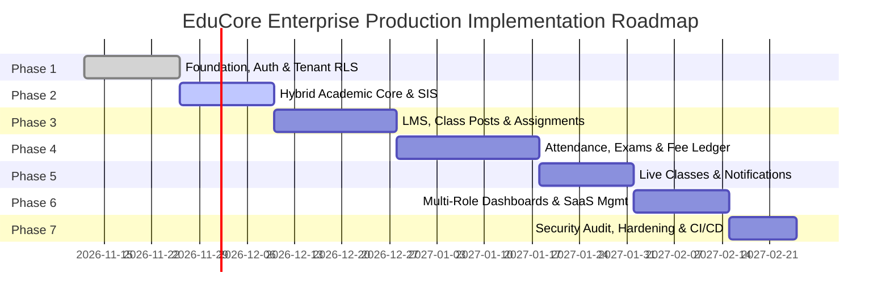

# EDUCORE — Master Project Plan, Implementation Phases & Roadmap
## 7-Phase Execution Plan, Work Breakdown Structure (WBS) & Risk Matrix

---

## 1. Executive Implementation Roadmap

EduCore follows a disciplined, 7-phase sequential engineering roadmap designed to construct a resilient multi-tenant architecture before deploying customer-facing operational modules.

---

## 2. Comprehensive Work Breakdown Structure (WBS)

### Phase 1 — Foundation, Design System & Multi-Tenant Security
**Objective:** Establish bulletproof tenant isolation, global authentication, subdomain routing, and UI design foundation.
- **WBS 1.1:** Setup repository tooling (Vite, TypeScript, React, Tailwind CSS, shadcn/ui atoms).
- **WBS 1.2:** Implement Cloudflare wildcard subdomain routing and client-side hostname detection (`bright.educore.com` vs. `lvh.me:5173`).
- **WBS 1.3:** Setup Supabase GoTrue authentication (Email, Password, Password Reset, MFA ready).
- **WBS 1.4:** Execute Core Database Schema Migration (`profiles`, `institutions`, `institution_memberships`, `institution_permissions`).
- **WBS 1.5:** Implement PostgreSQL RLS helper functions (`is_platform_founder`, `is_active_tenant_member`, `has_tenant_permission`).
- **WBS 1.6:** Build Institution Self-Service Onboarding flow (Tenant name, slug validation against reserved list, admin profile creation).
- **Milestone 1:** A user can register a new institution, resolve their custom subdomain, sign in, and have their session fenced strictly by PostgreSQL RLS.

---

### Phase 2 — Academic Hierarchy & Stakeholder Directories
**Objective:** Deliver the flexible dual-taxonomy academic engine and user directories (Students, Teachers, Managers, Guardians).
- **WBS 2.1:** Build Academic Years and Term management module with activation toggles.
- **WBS 2.2:** Build Hybrid Taxonomy UI:
  - School Model: Grade &rarr; Section &rarr; Subject.
  - Tuition / Coaching Model: Course &rarr; Batch &rarr; Subject.
- **WBS 2.3:** Faculty Directory & Teacher Assignment Engine:
  - Teacher profile creation with staff ID and credentials.
  - Dynamic subject and section/batch assignment matrix.
- **WBS 2.4:** Student Information System (SIS):
  - Student admission, profile, guardian associations, roll numbers.
  - CSV Bulk Student Import with client-side dry-run schema validation.
- **WBS 2.5:** Manager Delegation Panel:
  - Institution Admin interface to create managers and toggle fine-grained permission overrides (`member_permission_overrides`).
- **Milestone 2:** Complete academic structure configured with active enrollments, faculty allocations, and verified guardian links.

---

### Phase 3 — Learning Management, Content & Assignments
**Objective:** Empower teachers to publish rich learning resources and manage end-to-end assignment evaluation workflows.
- **WBS 3.1:** Class Posting Engine:
  - Rich text editor with formatting, video embed, and document attachments.
  - Targeted cohort publication (Grade/Section or Course/Batch).
  - Draft, schedule, publish, and pin workflow.
- **WBS 3.2:** Supabase Storage Pipeline:
  - Configured buckets (`class-materials`, `assignment-submissions`).
  - Pre-signed upload/download URLs with file-size and MIME type enforcement.
- **WBS 3.3:** Assignment Formulation:
  - Create assignment with instructions, attachments, maximum marks, deadline, and late submission rules.
- **WBS 3.4:** Student Submission Workspace:
  - Student file upload, submission history, deadline lock check enforced by PostgreSQL trigger.
- **WBS 3.5:** Evaluator Grading Interface:
  - Teacher split-screen viewer for submitted files, numeric mark entry, qualitative feedback, and batch grade publication.
- **Milestone 3:** Full cycle of posting class notes, publishing assignments, student homework uploads, and teacher grade publishing operational.

---

### Phase 4 — Core Educational Operations (Attendance, Exams & Fees)
**Objective:** Implement daily institutional operations, academic examination grading, and immutable minor-unit fee billing.
- **WBS 4.1:** Daily & Subject Attendance System:
  - Attendance session generation, quick-mark roster UI (Present, Absent, Late, Excused).
  - Composite unique constraints preventing duplicate session records.
  - Attendance summary analytics (student percentage, cohort averages).
- **WBS 4.2:** Examination & Report Card Engine:
  - Exam scheduling, maximum/passing marks, grade scales.
  - Mark entry grid, approval review workflow, and templated PDF report card generator.
- **WBS 4.3:** Fee Billing & Minor-Unit Financial Ledger:
  - Fee category and structure definitions (Tuition, Lab, Transport).
  - Individual student invoice generation with discount and scholarship deductions.
  - Append-only `payments` transaction ledger storing paise (`BIGINT`).
  - Cash/Cheque manual receipt collection and payment status reconciliation.
- **Milestone 4:** Full operational attendance tracking, exam report card generation, and zero-roundoff fee collection ledger active.

---

### Phase 5 — Communication Pipeline & Virtual Live Classes
**Objective:** Provide real-time omnichannel communications and scheduled virtual classrooms with agnostic video providers.
- **WBS 5.1:** Centralized Communications Engine:
  - Institutional and class-scoped announcements.
  - In-app notification bell with real-time Supabase subscription.
  - Transactional email dispatch via Resend Edge Functions.
- **WBS 5.2:** Virtual Live Class Scheduling:
  - Agnostic provider contract (Zoom, Google Meet, Jitsi Meet).
  - Session scheduling with agenda, start time, and estimated duration.
  - Secure credential isolation: Students only receive signed join URLs; host credentials remain strictly protected.
- **WBS 5.3:** Session Attendance Logging:
  - Participant join and departure timestamp logging to capture engagement duration.
- **Milestone 5:** Live virtual classes scheduled and joined seamlessly; real-time notifications alerting students across devices.

---

### Phase 6 — Role-Tailored Dashboards & Platform SaaS Governance
**Objective:** Deliver customized analytical dashboards for all 6 stakeholder roles and the Platform Founder portal.
- **WBS 6.1:** Platform Founder Portal:
  - Multi-tenant overview (active, pending, suspended institutions).
  - Platform-wide feature flag switches and subscription quota management.
  - Global telemetry, audit log inspection, and break-glass support access.
- **WBS 6.2:** Institution Admin Dashboard:
  - High-level KPIs: Active students, staff count, today's attendance rate, pending fee collection.
- **WBS 6.3:** Manager, Teacher, Student, and Parent Dashboards:
  - Strict UI filtering displaying only permitted widgets and cohorts.
- **Milestone 6:** All personas experience tailored, responsive, and metric-rich operational workspaces.

---

### Phase 7 — Production Hardening, Security Audits & Deployment
**Objective:** Verify non-functional requirements, execute security penetration tests, and establish production CI/CD.
- **WBS 7.1:** Automated RLS & Multi-Tenant Fencing Verification (pgTAP or Vitest suite testing cross-tenant leak scenarios).
- **WBS 7.2:** Performance Tuning: Query execution analysis, indexing verification, bundle tree-shaking, Lighthouse audit (>95 score).
- **WBS 7.3:** Error Monitoring & Observability: Sentry integration, PostHog product analytics, database slow-query logging.
- **WBS 7.4:** Disaster Recovery & Backup runbook: Automated continuous WAL archiving and snapshot restore verification.
- **Milestone 7:** Fully audited, high-performance, commercially deployable SaaS platform ready for customer onboarding.

---

## 3. Scope Matrix: MVP vs. Post-MVP Commercial Release

| Feature / Capability | Phase 1-3 (Core MVP) | Phase 4-5 (Operational MVP) | Phase 6-7 (Commercial Release) |
| :--- | :---: | :---: | :---: |
| Subdomain Tenant Isolation & Auth | **IN SCOPE** | IN SCOPE | IN SCOPE |
| Hybrid Academic Structure (School + Tuition) | **IN SCOPE** | IN SCOPE | IN SCOPE |
| Student & Teacher Directories | **IN SCOPE** | IN SCOPE | IN SCOPE |
| Class Posts & File Sharing | **IN SCOPE** | IN SCOPE | IN SCOPE |
| Assignment Workflow & Evaluation | **IN SCOPE** | IN SCOPE | IN SCOPE |
| Daily / Subject Attendance Registers | Planned | **IN SCOPE** | IN SCOPE |
| Examination & Report Card Engine | Planned | **IN SCOPE** | IN SCOPE |
| Fee Invoicing & Offline Ledger (Paise) | Planned | **IN SCOPE** | IN SCOPE |
| In-App Notification Center | Planned | **IN SCOPE** | IN SCOPE |
| Live Classes (Jitsi / Meet Integration) | Planned | **IN SCOPE** | IN SCOPE |
| Razorpay / Stripe Online Payment Gateway | Planned | Planned | **IN SCOPE** |
| Platform Founder Multi-Tenant Portal | Planned | Planned | **IN SCOPE** |
| Dynamic Custom Domains (`portal.school.com`)| Future Phase | Future Phase | Post-Release |

---

## 4. Architectural Risk Register & Mitigation Strategy

| Risk ID | Description & Potential Impact | Likelihood | Impact | Concrete Architectural Mitigation |
| :--- | :--- | :---: | :---: | :--- |
| **RSK-01** | **Cross-Tenant Data Leakage via Faulty RLS:** A missing RLS policy or flawed `OR` clause exposes Institution A's data to Institution B. | Low | Critical | **Mitigation:** Mandatory composite tenant keys `(institution_id, id)` across all tables; automated pgTAP unit tests simulating adversarial cross-tenant requests before every deployment. |
| **RSK-02** | **Subdomain Spoofing & Phishing:** Attacker registers a sensitive subdomain (e.g. `admin`, `api`, `support`, `billing`). | Medium | High | **Mitigation:** Strict database check constraint and API validation against a hardcoded reserved blacklist; alphanumeric regex validation. |
| **RSK-03** | **Financial Roundoff Discrepancies:** Floating point calculations create fractional cent/paisa errors in cumulative ledger balances. | Medium | High | **Mitigation:** Absolute ban on `FLOAT` or `NUMERIC` for currency; 100% of money fields stored as `BIGINT` representing integer paise. |
| **RSK-04** | **Storage Cost Explosion & Malicious Uploads:** Users upload multi-gigabyte or infected files to Supabase Storage. | High | Medium | **Mitigation:** Pre-signed upload validation checking file size limits (<50MB) and strict MIME type whitelists; tenant-level storage quotas enforced by edge functions. |
| **RSK-05** | **Manager Privilege Escalation:** Delegated manager exploits API endpoints to grant themselves fee access or create admins. | Low | Critical | **Mitigation:** Hardcoded RLS rejection preventing non-admin roles from writing to `institution_memberships` or modifying permission records. |
